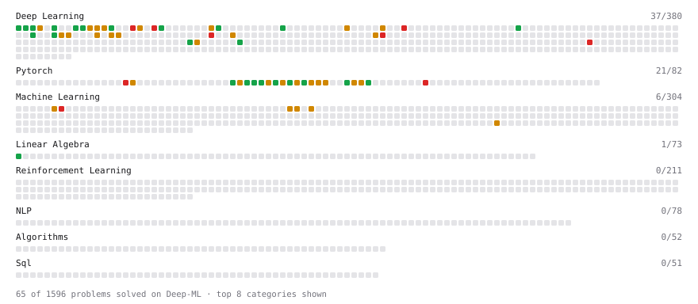

# Deep-ML

My machine learning practice from [Deep-ML](https://www.deep-ml.com). Every solution here was written by hand.

**67** solved · 67 problems · 0 labs · 0 math

[**Browse the interactive portfolio**](https://Haoyan-collab.github.io/deep-ml/) to replay this filling in over time.

## Problems

| | Difficulty | Solved | |
| --- | --- | --- | --- |
| [Apply Dropout to Attention Weights](https://www.deep-ml.com/problems/956) | easy | 2026-10-04 | [solution](problems/0956-apply-dropout-to-attention-weights) |
| [Batch a TensorDataset with DataLoader](https://www.deep-ml.com/problems/1237) | easy | 2026-10-08 | [solution](problems/1237-batch-a-tensordataset-with-dataloader) |
| [Compute Multi-class Cross-Entropy Loss](https://www.deep-ml.com/problems/134) | easy | 2026-10-09 | [solution](problems/0134-compute-multi-class-cross-entropy-loss) |
| [Count Parameters of a Sequential Model](https://www.deep-ml.com/problems/1218) | easy | 2026-10-08 | [solution](problems/1218-count-parameters-of-a-sequential-model) |
| [Create and Inspect a Tensor](https://www.deep-ml.com/problems/1220) | easy | 2026-10-07 | [solution](problems/1220-create-and-inspect-a-tensor) |
| [Gradient of a Square with Autograd](https://www.deep-ml.com/problems/1222) | easy | 2026-10-08 | [solution](problems/1222-gradient-of-a-square-with-autograd) |
| [Implement a Simple Residual Block with Shortcut Connection](https://www.deep-ml.com/problems/113) | easy | 2026-10-08 | [solution](problems/0113-implement-a-simple-residual-block-with-shortcut-connection) |
| [Implement Binary Cross-Entropy Loss](https://www.deep-ml.com/problems/263) | easy | 2026-09-30 | [solution](problems/0263-implement-binary-cross-entropy-loss) |
| [Implement ReLU Activation Function](https://www.deep-ml.com/problems/42) | easy | 2026-09-30 | [solution](problems/0042-implement-relu-activation-function) |
| [Implement ReLU and Leaky ReLU](https://www.deep-ml.com/problems/1226) | easy | 2026-10-08 | [solution](problems/1226-implement-relu-and-leaky-relu) |
| [Implement RMSNorm (Root Mean Square Layer Normalization)](https://www.deep-ml.com/problems/372) | easy | 2026-10-15 | [solution](problems/0372-implement-rmsnorm-root-mean-square-layer-normalization) |
| [Implement the Hard Sigmoid Activation Function](https://www.deep-ml.com/problems/96) | easy | 2026-10-04 | [solution](problems/0096-implement-the-hard-sigmoid-activation-function) |
| [Implementation of Log Softmax Function](https://www.deep-ml.com/problems/39) | easy | 2026-09-30 | [solution](problems/0039-implementation-of-log-softmax-function) |
| [KL Divergence Between Two Normal Distributions](https://www.deep-ml.com/problems/56) | easy | 2026-09-30 | [solution](problems/0056-kl-divergence-between-two-normal-distributions) |
| [Leaky ReLU Activation Function](https://www.deep-ml.com/problems/44) | easy | 2026-09-30 | [solution](problems/0044-leaky-relu-activation-function) |
| [Learned Positional Embeddings](https://www.deep-ml.com/problems/375) | easy | 2026-10-08 | [solution](problems/0375-learned-positional-embeddings) |
| [Matrix-Vector Dot Product](https://www.deep-ml.com/problems/1) | easy | 2026-10-07 | [solution](problems/0001-matrix-vector-dot-product) |
| [Mean Squared Error from Scratch](https://www.deep-ml.com/problems/1228) | easy | 2026-10-02 | [solution](problems/1228-mean-squared-error-from-scratch) |
| [One SGD Update Step](https://www.deep-ml.com/problems/1234) | easy | 2026-10-08 | [solution](problems/1234-one-sgd-update-step) |
| [Reshape and Transpose a Tensor](https://www.deep-ml.com/problems/1221) | easy | 2026-10-07 | [solution](problems/1221-reshape-and-transpose-a-tensor) |
| [Scale Attention Scores by sqrt(d_k)](https://www.deep-ml.com/problems/963) | easy | 2026-10-04 | [solution](problems/0963-scale-attention-scores-by-sqrt-d-k) |
| [Sigmoid Activation Function Understanding](https://www.deep-ml.com/problems/22) | easy | 2026-09-30 | [solution](problems/0022-sigmoid-activation-function-understanding) |
| [Single Linear Neuron Forward](https://www.deep-ml.com/problems/1224) | easy | 2026-10-07 | [solution](problems/1224-single-linear-neuron-forward) |
| [Single Neuron](https://www.deep-ml.com/problems/24) | easy | 2026-09-30 | [solution](problems/0024-single-neuron) |
| [Softmax Activation Function Implementation ](https://www.deep-ml.com/problems/23) | easy | 2026-09-30 | [solution](problems/0023-softmax-activation-function-implementation) |
| [Adam Optimizer](https://www.deep-ml.com/problems/87) | medium | 2026-10-03 | [solution](problems/0087-adam-optimizer) |
| [BatchNorm1d Forward in Eval Mode](https://www.deep-ml.com/problems/1231) | medium | 2026-10-08 | [solution](problems/1231-batchnorm1d-forward-in-eval-mode) |
| [Binary Cross-Entropy from Logits](https://www.deep-ml.com/problems/1229) | medium | 2026-10-08 | [solution](problems/1229-binary-cross-entropy-from-logits) |
| [Build Scaled Dot-Product Attention](https://www.deep-ml.com/problems/490) | medium | 2026-10-01 | [solution](problems/0490-build-scaled-dot-product-attention) |
| [Dropout in Train vs Eval Mode](https://www.deep-ml.com/problems/1230) | medium | 2026-10-08 | [solution](problems/1230-dropout-in-train-vs-eval-mode) |
| [Dropout Layer](https://www.deep-ml.com/problems/151) | medium | 2026-10-05 | [solution](problems/0151-dropout-layer) |
| [Find the Best Gini-Based Split for a Binary Decision Tree](https://www.deep-ml.com/problems/138) | medium | 2026-10-16 | [solution](problems/0138-find-the-best-gini-based-split-for-a-binary-decision-tree) |
| [Gradient of a Weighted Sum of Squares](https://www.deep-ml.com/problems/1223) | medium | 2026-10-08 | [solution](problems/1223-gradient-of-a-weighted-sum-of-squares) |
| [Implement a Transformer Encoder Block](https://www.deep-ml.com/problems/905) | medium | 2026-10-12 | [solution](problems/0905-implement-a-transformer-encoder-block) |
| [Implement Adam Optimization Algorithm](https://www.deep-ml.com/problems/49) | medium | 2026-10-02 | [solution](problems/0049-implement-adam-optimization-algorithm) |
| [Implement Batched Causal Self-Attention](https://www.deep-ml.com/problems/957) | medium | 2026-10-04 | [solution](problems/0957-implement-batched-causal-self-attention) |
| [Implement Efficient Sparse Window Attention](https://www.deep-ml.com/problems/131) | medium | 2026-10-10 | [solution](problems/0131-implement-efficient-sparse-window-attention) |
| [Implement Grouped Query Attention (GQA)](https://www.deep-ml.com/problems/391) | medium | 2026-10-10 | [solution](problems/0391-implement-grouped-query-attention-gqa) |
| [Implement K-Nearest Neighbors](https://www.deep-ml.com/problems/173) | medium | 2026-10-17 | [solution](problems/0173-implement-k-nearest-neighbors) |
| [Implement Layer Normalization for Sequence Data](https://www.deep-ml.com/problems/109) | medium | 2026-10-08 | [solution](problems/0109-implement-layer-normalization-for-sequence-data) |
| [Implement Masked Self-Attention](https://www.deep-ml.com/problems/107) | medium | 2026-10-02 | [solution](problems/0107-implement-masked-self-attention) |
| [Implement Multiquery Attention (MQA)](https://www.deep-ml.com/problems/390) | medium | 2026-10-10 | [solution](problems/0390-implement-multiquery-attention-mqa) |
| [Implement Position-wise Feed-Forward Block with Residual and Dropout](https://www.deep-ml.com/problems/178) | medium | 2026-10-04 | [solution](problems/0178-implement-position-wise-feed-forward-block-with-residual-and-dropout) |
| [Implement Self-Attention Mechanism](https://www.deep-ml.com/problems/53) | medium | 2026-10-01 | [solution](problems/0053-implement-self-attention-mechanism) |
| [Implementing a Simple RNN](https://www.deep-ml.com/problems/54) | medium | 2026-10-15 | [solution](problems/0054-implementing-a-simple-rnn) |
| [KV Cache for Efficient Autoregressive Attention](https://www.deep-ml.com/problems/376) | medium | 2026-10-04 | [solution](problems/0376-kv-cache-for-efficient-autoregressive-attention) |
| [Numerically Stable Softmax](https://www.deep-ml.com/problems/1227) | medium | 2026-10-07 | [solution](problems/1227-numerically-stable-softmax) |
| [One Adam Update Step](https://www.deep-ml.com/problems/1236) | medium | 2026-10-08 | [solution](problems/1236-one-adam-update-step) |
| [One Training Step](https://www.deep-ml.com/problems/1219) | medium | 2026-10-07 | [solution](problems/1219-one-training-step) |
| [Pre-Norm vs Post-Norm Transformer Block](https://www.deep-ml.com/problems/408) | medium | 2026-10-05 | [solution](problems/0408-pre-norm-vs-post-norm-transformer-block) |
| [Principal Component Analysis (PCA) Implementation](https://www.deep-ml.com/problems/19) | medium | 2026-10-15 | [solution](problems/0019-principal-component-analysis-pca-implementation) |
| [RoPE with Position Offset for KV Cache](https://www.deep-ml.com/problems/1029) | medium | 2026-10-08 | [solution](problems/1029-rope-with-position-offset-for-kv-cache) |
| [Rotary Positional Embeddings (RoPE)](https://www.deep-ml.com/problems/381) | medium | 2026-10-08 | [solution](problems/0381-rotary-positional-embeddings-rope) |
| [SGD with Momentum Step](https://www.deep-ml.com/problems/1235) | medium | 2026-10-08 | [solution](problems/1235-sgd-with-momentum-step) |
| [Single Neuron with Backpropagation](https://www.deep-ml.com/problems/25) | medium | 2026-10-01 | [solution](problems/0025-single-neuron-with-backpropagation) |
| [Sliding Window Attention](https://www.deep-ml.com/problems/388) | medium | 2026-10-10 | [solution](problems/0388-sliding-window-attention) |
| [Two-Layer MLP Forward Pass](https://www.deep-ml.com/problems/1225) | medium | 2026-10-07 | [solution](problems/1225-two-layer-mlp-forward-pass) |
| [Build a Transformer Encoder Layer](https://www.deep-ml.com/problems/491) | hard | 2026-10-05 | [solution](problems/0491-build-a-transformer-encoder-layer) |
| [Causal and Padding Masks with scaled_dot_product_attention](https://www.deep-ml.com/problems/1346) | hard | 2026-10-13 | [solution](problems/1346-causal-and-padding-masks-with-scaled-dot-product-attention) |
| [Decision Tree Learning](https://www.deep-ml.com/problems/20) | hard | 2026-10-16 | [solution](problems/0020-decision-tree-learning) |
| [Flash Attention v1 - Forward Pass](https://www.deep-ml.com/problems/208) | hard | 2026-10-12 | [solution](problems/0208-flash-attention-v1-forward-pass) |
| [Implement Bagging Classifier from Scratch](https://www.deep-ml.com/problems/307) | hard | 2026-10-17 | [solution](problems/0307-implement-bagging-classifier-from-scratch) |
| [Implement Multi-Head Attention](https://www.deep-ml.com/problems/94) | hard | 2026-10-03 | [solution](problems/0094-implement-multi-head-attention) |
| [Implement Multi-Head Self-Attention](https://www.deep-ml.com/problems/904) | hard | 2026-10-13 | [solution](problems/0904-implement-multi-head-self-attention) |
| [Multi-Head Latent Attention (MLA)](https://www.deep-ml.com/problems/405) | hard | 2026-10-12 | [solution](problems/0405-multi-head-latent-attention-mla) |
| [Positional Encoding Calculator](https://www.deep-ml.com/problems/85) | hard | 2026-10-08 | [solution](problems/0085-positional-encoding-calculator) |
| [Pre-Norm GPT Transformer Block Forward Pass](https://www.deep-ml.com/problems/1056) | hard | 2026-10-04 | [solution](problems/1056-pre-norm-gpt-transformer-block-forward-pass) |

---

_This file is regenerated by Deep-ML on every push._
